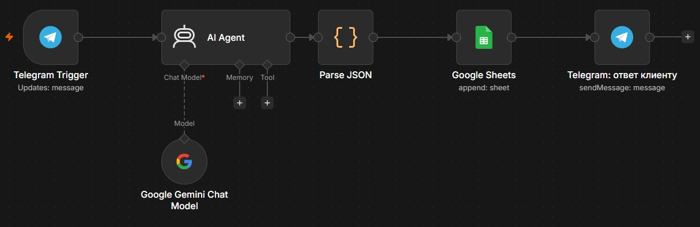
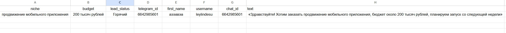
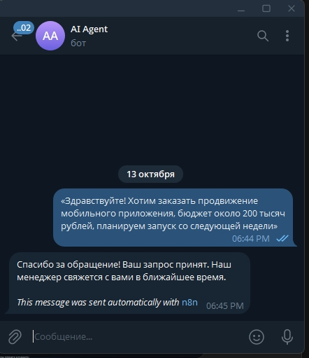

# Telegram Lead Qualification Bot

> Автоматическая квалификация входящих лидов из Telegram: LLM разбирает сообщение, заносит данные в Google Sheets и отправляет клиенту автоответ.


---

## 💼 Бизнес-задача

Отдел продаж маркетингового агентства тратит время на ручной разбор входящих сообщений из Telegram: кто-то пишет «скидка на лендинг до пятницы», кто-то спрашивает про погоду. Задача — отфильтровать нецелевые обращения, определить бюджет и срочность, разложить лидов по таблице и мгновенно ответить клиенту, чтобы ни одно обращение не потерялось.

**До автоматизации:** менеджер читает чат, вручную копирует контакты в таблицу, отвечает шаблоном.
**После:** каждое сообщение попадает в CRM-таблицу со статусом за секунды, клиент сразу получает автоответ, менеджер работает только с горячими лидами.

---

## 🧭 Как это работает

```
Telegram (входящее сообщение)
        │
        ▼
Telegram Trigger  ──►  AI Agent (LLM, JSON mode)
        │                        │
        │                        ▼
        │                  Parse JSON (код-нода)
        │                        │
        │                        ▼
        │                  Google Sheets (Append Row)
        │                        │
        ▼                        ▼
Telegram Send  ◄─── автоответ клиенту
```

| Этап | Нода | Что происходит |
| --- | --- | --- |
| 1 | **Telegram Trigger** | Перехватывает входящий текст (`message.text`) |
| 2 | **AI Agent + LLM** | Анализирует сообщение и возвращает валидный JSON: `niche`, `budget`, `lead_status` |
| 3 | **Code (Parse JSON)** | Парсит ответ LLM, срезает markdown-обёртки, добавляет поля Telegram |
| 4 | **Google Sheets** | Добавляет строку: дата, Telegram ID, имя, ниша, бюджет, статус лида |
| 5 | **Telegram Send** | Отправляет клиенту подтверждение о принятии заявки |

**Правила квалификации:**

| Статус | Условие |
| --- | --- |
| 🔥 Горячий | Бюджет > 100 000 ₽ или есть срочный запрос |
| 🌤 Теплый | Бюджет меньше или не указан |
| 🗑 Нецелевой | Спам или вопрос не по теме |

---

## 📸 Скриншоты

### Архитектура воркфлоу



### Выгрузка лидов в Google Sheets



### Автоответ клиенту в Telegram



---

## 🛠 Стек

- **n8n** — оркестрация воркфлоу (workflow-as-code, версионируется в git)
- **Telegram API** — Trigger и отправка сообщений (BotFather)
- **LLM API** — извлечение структурированных данных из текста
- **Google Sheets API** — выгрузка лидов в таблицу «Лиды из Telegram»
- **JSON** — формат обмена между нодами, готовый к импорту

---

## ⚡ Быстрый старт

### 1. Импорт воркфлоу

Откройте n8n → **Workflows → Import from JSON** → вставьте содержимое `workflow.json`.

### 2. Подключение креденшелов

| Сервис | Что нужно | Где брать |
| --- | --- | --- |
| **Telegram** | Bot Token | [@BotFather](https://t.me/BotFather) → `/newbot` |
| **LLM** | API-ключ | Панель провайдера (OpenAI / GigaChat / совместимый endpoint) |
| **Google Sheets** | OAuth2 Client ID + Secret | [Google Cloud Console](https://console.cloud.google.com) → включить **Sheets API** и **Drive API** → OAuth consent screen → Credentials → Web application |

В n8n ноды показывают `Credential → Create new` — ключи вставляются только туда, в сам JSON они не попадают.

### 3. Настройка таблицы

Создайте Google-таблицу с листом и заголовками в первой строке:

| Дата | Telegram ID | Имя пользователя | Ниша/Запрос | Бюджет | Статус лида |
| --- | --- | --- | --- | --- | --- |

В ноде Google Sheets укажите **Document ID** (из URL таблицы) и имя листа.

### 4. Запуск

1. Проверьте сценарий через **Listen for Test Event** в Telegram Trigger.
2. Напишите боту: *«Нужен сайт для стоматологии, бюджет 150 000, срочно»*.
3. Убедитесь, что лид появился в таблице со статусом **Горячий**, а клиент получил автоответ.
4. Включите переключатель **Active**.

---

## 📁 Структура проекта

```
lead-qualification-bot/
├── workflow.json       # сценарий n8n для импорта
├── architecture.png    # скриншот архитектуры
├── google-sheets.png   # скриншот выгрузки в таблицу
├── telegram-reply.png  # скриншот автоответа
└── README.md
```

---

## 🚀 Возможные доработки

- **Ветвление по статусу** — «Нецелевой» не пишется в таблицу, а получает другой ответ.
- **Уведомление менеджера** — отдельный чат с оповещением о горячих лидах.
- **Дедупликация** — проверка Telegram ID перед добавлением строки.
- **Аналитика** — дашборд по статусам и бюджетам (см. проект [ai-review-analyzer](https://github.com/leyylin/ai-review-analyzer)).

---

## 📄 Лицензия

MIT
